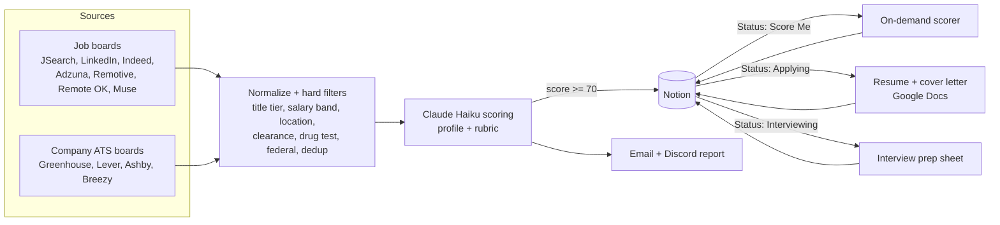

# n8n Job Scout

A job-search pipeline built on n8n. It pulls postings from job boards and from
company ATS boards, filters out the ones that can never fit, has Claude score
the rest against your profile, and files the matches in Notion. When you mark
a job in Notion, it can score a job you added by hand, write a tailored resume
and cover letter into Google Docs, or build an interview prep sheet.

This repo is a **template**. The workflows are exports of a working setup with
every credential, ID and personal detail replaced by a placeholder. You fill in
your own profile, keys and Notion databases. **[SETUP.md](SETUP.md)** walks
through it.

## Workflows

| Workflow | Trigger | What it does |
|---|---|---|
| **Job Search - Daily Scout** | daily 14:00 | Broad search: JSearch, LinkedIn, Indeed, Adzuna, Remotive, Remote OK, The Muse, plus local-city JSearch queries. Filters, dedups, scores with Claude Haiku, saves 70+ to Notion, then emails and Discords a report. |
| **Job Search - Dream Scout** | daily 15:00 | Same sources with a stricter "dream job" rubric (small company, multi-domain role). Surfaces only 80+. |
| **Job Search - ATS Scout** | daily 15:00 | Polls a hand-picked list of companies' Greenhouse / Lever / Ashby / Breezy boards (plus HTML and sitemap scrapers) instead of aggregators. Suppresses roles you have already been through. |
| **job-scout-cloud** | daily 14:15 | A "lane" focused on cloud networking, with local radius searches. Writes to its own Notion database. |
| **job-scout-security** | daily 14:30 | A lane focused on network security. Writes to its own Notion database. |
| **Job Application Doc Generator** | every 10 min | Polls Notion. **Status = Score Me**: fetches the posting and scores it like a scouted job. **Status = Applying**: scores it if needed, then writes a tailored resume and cover letter into a Drive folder. |
| **Job Apply From URL** | webhook | `GET/POST /webhook/apply-url?url=<job URL>` creates the Notion row and the documents in one call. |
| **Job Interview Prep** | every 10 min | **Status = Interviewing**: writes a prep sheet (likely questions, gap questions, questions to ask) into the job's Drive folder and links it in Notion. |
| **Job Scout - Apply Nudge** | daily 00:00 | Discord reminder listing high-scoring jobs still sitting at `New`. |

Cron times are in the n8n instance's timezone (UTC on a default install).



## How scoring works

1. **Hard filters run first, in code**, so Claude is never paid to score a job
   that cannot fit: developer titles, SRE/DevOps titles, clearance, federal
   employers, salary bands topping out below your floor, onsite roles outside
   your area, and stale or duplicate postings.
2. **A deterministic pre-score** is computed for every survivor. It has a
   *title tier* (primary / secondary / other) and a *skill overlap* (0-100)
   against skill clusters you define. It ranks jobs inside each run's cap and
   is handed to Claude as evidence.
3. **Claude scores against your profile and a rubric** of disqualifiers,
   penalties and bonuses, and returns JSON: score, two-sentence fit summary,
   missing skills, red flags, tags, resume tips and a cover-letter hook.

The rubric and the tier/overlap block are copied into several workflows.
If you change one, change the others too, or the scouts and the on-demand
scorer will score on different scales. [SETUP.md](SETUP.md#6-make-it-yours)
lists where each copy lives.

## Repo layout

```
workflows/          n8n exports - import these
src/
  ats_scout_src/    ATS Scout node code + offline harness
  scorer_src/       On-demand scorer node code + harness
  interview_src/    Interview prep node code + harness
  lanes_src/        Cloud / Security lane node code
scout-targets.yml   ATS Scout company list (example)
SETUP.md            Step-by-step install
TROUBLESHOOTING.md  Known failure modes
```

`src/` holds the readable source of the Code nodes, and each `harness.js`
replays a whole pipeline offline in Node. Run it after editing filter or
parsing logic and before pasting the change into n8n:

```bash
cd src/scorer_src && node harness.js        # needs no network
cd src/ats_scout_src && ./fetch_fixtures.sh && node harness.js
```

## Requirements

- n8n 1.x or later (self-hosted or cloud)
- An Anthropic API key. Scoring uses Claude Haiku, which costs cents per run;
  document generation uses Claude Sonnet.
- A Notion integration and up to three job databases
- A RapidAPI key subscribed to JSearch (LinkedIn and Indeed APIs are optional)
- An Adzuna app ID and key (free tier)
- Optional: Gmail SMTP for email reports, a Discord webhook, Google Docs/Drive
  OAuth for documents, and InfluxDB for AI cost tracking

## License

This project is provided as-is for educational and personal use.
